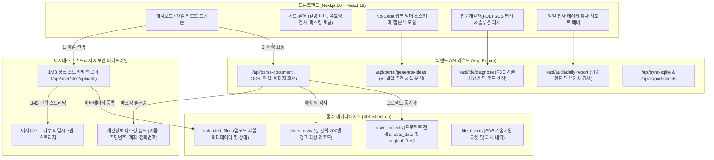

# 📋 FileToSheet (파일투시트) AI 에이전트 종합 인수인계 문서 (Agent Handover Pack)

> **문서 버전**: v1.0.0 (2026-10-20 KST 기준)  
> **대상**: FileToSheet 프로젝트에 투입되는 모든 AI 에이전트 및 전문개발자(FDE)  
> **원본 아카이빙 위치**: `C:\Users\COM\Documents\EGDesk\Knowledge Wiki\Work Logs\FileToSheet.md` (단일 지식 베이스 동기화 완료)  
> **프로젝트 루트 경로**: `c:\dev\FileToSheet`  
> **공식 슬로건**: *"어떤 파일이든 업로드 즉시 엑셀 표로, FileToSheet"*  
> **호스팅 환경**: 이지데스크 코딩 서버 (포트 4003) | Next.js 16.4.1 (Turbopack) | React 19.3.0 | TypeScript 5 | TailwindCSS v4  
> **깃허브 저장소**: `https://github.com/Charismagreat/FileToSheet.git` (main 브랜치)

---

## 1. 프로젝트 핵심 개요 및 아키텍처

### 1.1 서비스 미션
종이 거래명세서, PDF 계약서, 영수증 이미지, 통장 거래내역 엑셀, 카카오톡/음성 주문 녹취록 등 **기업 현장의 파편화된 모든 비정형/정형 문서를 단 한 번의 업로드로 표준화된 엑셀 표(시트)로 전환**하고, 이를 기반으로 **No-Code 웹앱 생성, 전사 데이터 감사, 외부 DB/구글 시트 연동**까지 지원하는 올인원 업무 자동화 플랫폼입니다.

### 1.2 시스템 아키텍처 다이어그램


---

## 2. 물리 데이터베이스 스키마 (`data/filetosheet.db`)

모든 사용자 프로젝트, 업로드 파일, 파싱 행 데이터는 로컬스토리지에 머무르지 않고 SQLite 물리 DB에 영구 보존됩니다.

| 테이블명 | 주요 컬럼 | 설명 |
| :--- | :--- | :--- |
| **`user_projects`** | `id`, `user_id` (휴대폰 번호), `project_name`, `sheets_data` (JSON 문자열), `original_files` (JSON 문자열), `updated_at` | 워크스페이스의 모든 시트 데이터(행/열 셀값)와 업로드된 원본 파일 메타데이터 배열을 영구 보존하는 핵심 테이블 |
| **`uploaded_files`** | `id`, `filename`, `file_type`, `file_size`, `file_data` (스토리지 참조), `status`, `category`, `sheet_names`, `row_count`, `created_at` | 사용자가 업로드한 원본 파일의 규격, 파싱 진행 상태 및 결과 메타데이터 |
| **`sheet_rows`** | `id`, `file_id`, `sheet_name`, `row_index`, `row_data` (JSON 행 데이터), `category`, `created_at` | 대용량 시트의 빠른 인덱싱 및 조회를 위해 200행 단위로 분할 적재되는 행 레벨 테이블 |
| **`fde_tickets`** | `id`, `ticket_no`, `user_phone`, `project_name`, `user_request`, `status`, `tech_spec`, `solution_code`, `created_at` | 전문개발자 SOS 요청 건별 진단 결과, 스키마 갭, 적용된 자동 패치 및 진행 이력 |
| **`audit_reports`** | `id`, `audit_date`, `total_rows`, `duplicate_count`, `vat_error_count`, `overall_match_rate`, `report_summary` | 전사 일일 데이터 감사 배치 실행 결과 및 이상 거래 적발 요약 |

---

## 3. 핵심 기능별 세부 구현 및 위치

### 3.1 개인정보 마스킹 실드 (Privacy Masking Shield)
- **소스 위치**: `src/lib/maskingUtils.ts`
- **목적**: 화면 노출 및 AI 전송 시 고객 개인정보 및 사내 민감 금융 데이터 자동 난독화
- **정규식 난독화 사양**:
  - **전화번호**: `010-1234-5678` ➔ `010-****-5678`
  - **이메일**: `ceo_hong@company.co.kr` ➔ `ce****@company.co.kr`
  - **주민등록번호**: `850101-1234567` ➔ `850101-*******`
  - **사업자등록번호**: `123-45-67890` ➔ `123-**-67890`
  - **성명**: 2~3글자 한글 성명 가운데 글자 마스킹 (`홍길동` ➔ `홍*동`)

### 3.2 AI 전사 일일 데이터 감사 엔진 (Daily Audit Engine)
- **소스 위치**: `src/app/api/audit/daily-report/route.ts`
- **검증 규칙**:
  1. **이중 전표 적발**: 동일 일자 + 동일 거래처 + 동일 금액이 5분 이내 중복 등록된 결함 추적.
  2. **부가세 정합성 검증**: 공급가액의 10%와 세액 컬럼의 차이가 ±1원을 초과하는 회계 오류 검출.
  3. **정합성 지수**: 전사 데이터 매칭율(`overallMatchRate`) 산출 및 C-Level용 요약 보고서 자동 생성.

### 3.3 No-Code 웹앱 빌더 & 스키마 갭 분석
- **소스 위치**: `src/app/api/portal/generate-ideas/route.ts` & `src/components/PortalAppModal.tsx`
- **동작 원리**:
  - 사용자가 업로드한 기존 시트(예: `고객사마스터`)를 분석하고, 사용자가 만들고자 하는 앱(예: `거래처 수주 및 출고 관리 앱`)에 필요한 **누락된 보조 시트(Schema Gap)**(`발주서`, `출고배송`)를 자동 역설계.
  - 빈 테이블이 아닌 즉시 테스트 가능한 **현실적 가상 샘플 데이터 3행**(`(주)대한상사`, `CJ대한통운 6542-...`)을 자동 주입하여 완성도 높은 앱 미리보기 제공.

### 3.4 전문개발자(FDE: Forward Deployed Engineer) 지원 시스템
- **소스 위치**: `src/app/api/fde/diagnose/route.ts` & `src/components/FdeSupportModal.tsx`
- **동작 원리**:
  - 노코드 빌더에서 해결하기 어려운 복합 ERP 연동, 외부 API 동기화, Google Apps Script 트리거 작성을 지원.
  - 고유 티켓 번호 발급(`FDE-YYYYMMDD-XXXX`), 스키마 갭 분석, 기술 사양서(Tech Spec Markdown), 원클릭 패치 코드 및 Google Apps Script 코드를 자동 생성하여 제공.

### 3.5 안전한 파일 스토리지 & 로컬스토리지 정책
- **검증 일시**: 2026-10-20 전수 점검 통과.
- **원칙**:
  - 원본 파일은 브라우저 `localStorage`에 **절대 저장하지 않음** (용량 한계 및 유실 방지).
  - 1MB 청크 단위 스트리밍(`uploadFileChunked`)으로 **이지데스크 스토리지**에 영구 보존.
  - 모든 행 데이터는 SQLite `user_projects`에 영구 적재.

---

## 4. API 엔드포인트 디렉토리

| 라우트 경로 | 메서드 | 용도 및 설명 |
| :--- | :---: | :--- |
| `/api/parse-document` | POST | 엑셀/PDF/이미지/음성 파일 파싱 및 표준 시트 구조화 변환 |
| `/api/portal/generate-ideas` | POST | 사용자 시트 기반 No-Code 웹앱 추천 및 스키마 갭 분석, 샘플 데이터 생성 |
| `/api/fde/diagnose` | POST | 전문개발자(FDE) 기술 사양서 작성, 스키마 갭 도출 및 자동 패치 코드 생성 |
| `/api/audit/daily-report` | GET/POST | 전사 전표 이중 발행 및 부가세 10% 오차 검증 일일 감사 리포트 |
| `/api/user/files/uploads` | POST | 대용량 파일 1MB 청크 스트리밍 업로드 수신 엔드포인트 |
| `/api/sync-sqlite` | POST | 프론트엔드 작업 내역을 로컬 SQLite DB와 동기화 |
| `/api/export-sheets` | POST | 파싱 및 정제된 시트를 Google Sheets로 자동 전송 |
| `/api/export-sqlite` | GET | 전체 데이터베이스를 다운로드 가능한 SQLite 파일로 덤프 |
| `/api/auth/phone` | POST | 6자리 SMS 인증번호 기반 휴대폰 간편 로그인 |

---

## 5. AI 에이전트 필수 행동 수칙 및 컨벤션

새롭게 작업을 이어받는 에이전트는 다음 수칙을 **예외 없이 100% 준수**해야 합니다.

1. **언어 규칙**:
   - 모든 답변, 소스코드 주석, 커밋 메시지, 보고서는 **반드시 한국어**로 작성합니다.
2. **단일 아카이빙 지식 베이스 동기화**:
   - 대화 및 작업 내용(요구사항, 기술적 결정, 코드 변경, 디버깅 내역 등)은 날짜별로 분할 파일을 만들지 않습니다.
   - 항상 `C:\Users\CHARISMA\OneDrive\Documents\EGDesk\Knowledge Wiki\Work Logs\FileToSheet.md` **상단에 지속적으로 누적 업데이트**합니다.
   - 문서 업데이트 후 반드시 MCP 도구 `obsidian_index`를 실행하여 최신 지식 베이스 색인을 동기화합니다.
3. **Next.js 16 / React 19 최신 문법 준수**:
   - `params`, `searchParams`, `cookies()`, `headers()` 등은 비동기(`await`) API입니다.
   - TailwindCSS v4를 사용 중이므로 기존 v3 설정 파일(`tailwind.config.js`)과의 혼용에 주의합니다.
4. **로컬스토리지 보수적 사용 원칙**:
   - 사용자 업로드 파일, 파싱된 거대 배열 데이터는 로컬스토리지에 저장하지 말고 이지데스크 스토리지 및 DB 파이프라인을 통하도록 유지합니다.
5. **파이썬 환경 및 데이터 시각화**:
   - 가상환경은 새로 만들지 않고 기존 uv 기반 `.venv`를 사용합니다.
   - matplotlib 기반 시각화 시 한글 폰트는 `koreanize-matplotlib`를 사용하며, seaborn의 스타일 설정은 사용하지 않습니다.

---

## 6. 빠른 검증 및 실행 커맨드

```bash
# 개발 서버 실행 (이지데스크 호스팅 환경 대응)
npm run dev

# 빌드 정적 분석 및 TypeScript 컴파일 검증
npm run build

# Git 작업 트리 상태 확인
git status
```
